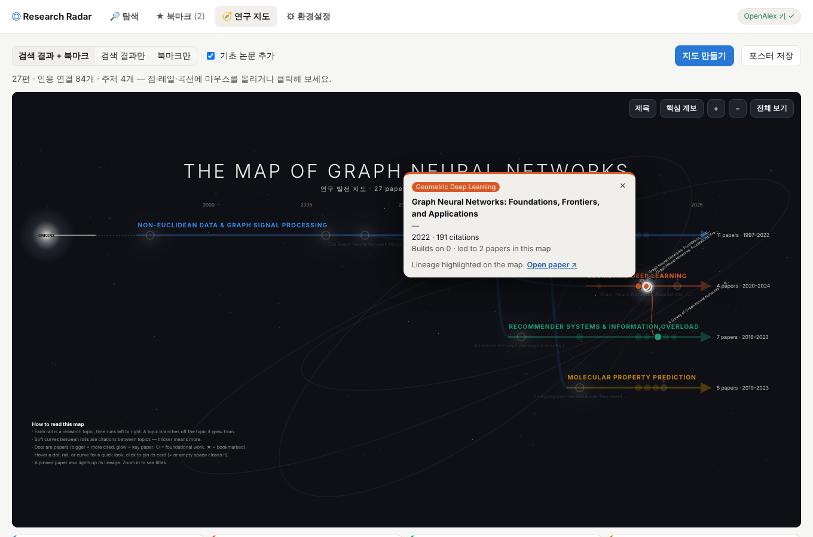
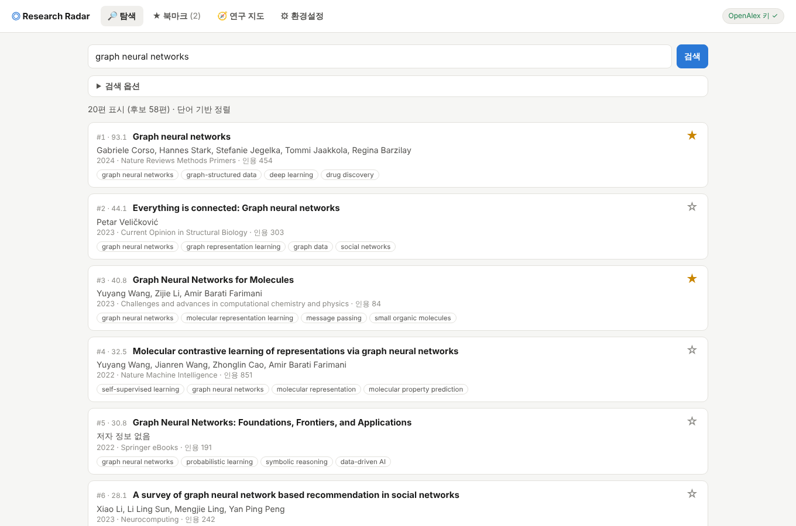

# Research Radar

**내 연구 주제에 맞는 논문을 찾고, 중요한 논문을 북마크하고, 그 분야가 어떻게 발전해 왔는지를 테크트리 형태의 연구 흐름으로 보여주는 PC 앱입니다.** 화면은 한국어와 영어를 지원합니다.

논문 데이터는 무료 학술 데이터베이스 [OpenAlex](https://openalex.org)에서 가져옵니다.

## ⬇ 다운로드

최신 버전 **v0.8.0**:

| Windows | macOS | Linux | Android |
|---|---|---|---|
| [ResearchRadar-0.8.0-windows.zip](https://github.com/Pinchpeach/research-radar/releases/download/v0.8.0/ResearchRadar-0.8.0-windows.zip) | [ResearchRadar-0.8.0-macos.zip](https://github.com/Pinchpeach/research-radar/releases/download/v0.8.0/ResearchRadar-0.8.0-macos.zip) | [ResearchRadar-0.8.0-linux.tar.gz](https://github.com/Pinchpeach/research-radar/releases/download/v0.8.0/ResearchRadar-0.8.0-linux.tar.gz) | [ResearchRadar-0.8.0-android.apk](https://github.com/Pinchpeach/research-radar/releases/download/v0.8.0/ResearchRadar-0.8.0-android.apk) |

모든 버전과 체크섬([SHA256SUMS.txt](https://github.com/Pinchpeach/research-radar/releases/download/v0.8.0/SHA256SUMS.txt))은 [**최신 릴리스 페이지**](https://github.com/Pinchpeach/research-radar/releases/latest)에 있습니다. 설치 방법은 [아래](#설치)를 보세요. Android 앱은 [여기](#android-앱)를 보세요.



## 주요 기능

앱은 **홈** 화면에서 시작합니다. 인사말 아래 검색창에 주제를 넣으면 바로 연구 탐색으로 넘어가고, 최근 찾아본 주제를 눌러 다시 검색할 수 있습니다. 왼쪽 위 **☰** 메뉴로 아래 화면들을 오갑니다.

| 화면 | 하는 일 |
|---|---|
| 🔎 **연구 탐색** | 연구 주제로 논문을 찾아 **◆ 핵심 흐름**(분야를 이해하는 데 중요한 논문)과 **🆕 최신 연구**(최근 연구) 두 묶음으로 보여줍니다. 출판 연도 필터, 시드 논문(이미 아는 핵심 논문을 인용하거나 그 논문이 인용한 논문까지 탐색), 정렬 가중치를 조절할 수 있습니다. **정렬 평가**를 켜면 결과마다 관련/부분/무관을 표시해 Precision@10·20과 nDCG@20을 보고, 저장한 평가를 설정별로 비교할 수 있습니다. |
| ★ **북마크** | ☆를 눌러 논문을 저장하고 메모와 태그를 붙입니다. 태그별로 거르고 BibTeX로 내보낼 수 있습니다. |
| 🧭 **연구 흐름** | 검색 결과나 북마크를 *The Map of Physics* 스타일의 테크트리로 그립니다. 처음에는 큰 흐름만 보이고, 선 위의 점에 마우스를 올리거나 클릭하면 세부 정보가 나옵니다. HTML 포스터로 저장할 수 있습니다. 열면 최근 검색 결과로 바로 그려지고, 휴대폰에서는 가장 최근 연구부터 보여 옆으로 넘기며 거슬러 올라갑니다. |
| 🔔 **새소식** | 버전마다 바뀐 점과 새 버전 알림을 보여 줍니다. |
| ⚙ **설정** | **API 키** 탭에서 OpenAlex API 키를 입력하고 바로 확인합니다. **언어** 탭에서 한국어/영어를 바꿉니다. 앱 화면과 연구 흐름 포스터가 함께 바뀌고, 논문 제목과 주제 이름은 원문 그대로 둡니다. **정보** 탭에 버전이 나오고 검색 기록을 지울 수 있습니다. |



### 연구 흐름 읽는 법

- **레일:** 연구 주제 하나가 레일 하나입니다. 레일은 그 주제가 처음 나타난 시점에서 시작합니다. 다른 주제에서 자라난 주제는 그 주제의 레일에서 곡선으로 갈라져 나오고, 나머지는 왼쪽의 **기원(ORIGINS)**에서 시작합니다.
- **곡선:** 레일 사이를 잇는 곡선은 주제 간 인용입니다. 굵을수록 인용이 많습니다.
- **점:**
  - 점 하나가 논문 하나이고, 클수록 많이 인용된 논문입니다.
  - 빛나는 점은 핵심 논문입니다.
  - ○는 기초 논문(결과 여러 편이 인용한 오래된 핵심 논문)입니다.
  - ★는 북마크한 논문입니다.
- **마우스 올리기:** 바로 미리보기가 나옵니다.
- **클릭:** 카드가 떠 있습니다. 빈 곳을 누르거나 ×, Esc로 닫습니다. 논문을 클릭하면 그 논문의 계보(바탕이 된 논문과 이어받은 논문)가 강조됩니다.
- **이동과 확대:** 스크롤로 위아래, Shift+스크롤로 좌우로 움직입니다. Ctrl(macOS는 ⌘)+스크롤이나 트랙패드 핀치, 더블클릭, **+ / −** 버튼으로 확대합니다. 방향키로 움직이고 0으로 전체 보기로 돌아갑니다. 확대하면 아래에 **타임라인 막대**가 나와 보이는 구간을 보여 주고, 끌어서 옮길 수 있습니다. 연도 눈금은 항상 아래에 붙어 있습니다.
- **논문 제목:** 제목은 확대해도 같은 크기로 표시되고 **서로, 그리고 점이나 주제 이름과 겹치지 않는 자리에만** 놓입니다. 중요한 논문(핵심 논문, 북마크, 많이 인용된 논문)이 먼저 자리를 잡습니다. 자리가 부족하면 짧은 제목이나 가는 연결선이 달린 제목으로 대신합니다. 처음 화면에는 핵심 논문 제목만 보이고, 확대할수록 점 사이가 벌어져 더 많은 제목이 나타납니다. **제목** 버튼을 누르면 확대하지 않아도 들어갈 수 있는 제목을 모두 보여줍니다.
- **핵심 계보:** 서로 차례로 인용하는 가장 긴 논문 사슬을 보여줍니다.

## 설치

### 다운로드

맨 위 [다운로드](#-다운로드) 링크나 [**최신 릴리스 페이지**](https://github.com/Pinchpeach/research-radar/releases/latest)에서 운영체제에 맞는 파일을 받으세요.

| 운영체제 | 파일 | 실행 방법 |
|---|---|---|
| Windows | `ResearchRadar-<버전>-windows.zip` | 압축을 풀고 `ResearchRadar\ResearchRadar.exe`를 실행합니다. 처음 실행할 때 "Windows의 PC 보호" 창이 뜨면 **추가 정보 → 실행**을 누르세요. |
| macOS | `ResearchRadar-<버전>-macos.zip` | 압축을 풀고 `Research Radar.app`을 응용 프로그램 폴더로 옮깁니다. 처음에는 **우클릭 → 열기**로 실행하세요. |
| Linux | `ResearchRadar-<버전>-linux.tar.gz` | 압축을 풀고 `ResearchRadar/ResearchRadar`를 실행합니다. 창을 띄우려면 GTK 또는 Qt WebView가 필요하고, 없으면 기본 브라우저로 열립니다. |

> 앱에 코드 서명이 되어 있지 않아 첫 실행 때 운영체제 경고가 나옵니다. 내려받은 파일은 릴리스에 함께 올라가는 `SHA256SUMS.txt`로 확인할 수 있습니다.

### Android 앱

휴대폰에서도 같은 화면(탐색, 북마크, 연구 흐름, 환경설정)을 씁니다. PC 앱과 달리 앱 안에 서버가 없고, 검색·정렬·흐름 분석을 휴대폰에서 직접 계산합니다(아래 [작동 방식](#android-앱의-구조)).

- **설치:** 릴리스의 `ResearchRadar-<버전>-android.apk`를 휴대폰에서 내려받아 엽니다. 처음에는 브라우저(또는 파일 앱)에 **출처를 알 수 없는 앱 설치**를 허용해야 합니다. Android 7 이상에서 동작합니다.
- **사용법:** 연구 흐름은 한 손가락으로 끌어서 옮기고 두 손가락으로 확대합니다. 점을 누르면 카드가 뜹니다. BibTeX와 포스터 저장은 Android 공유 창(Drive, 메일, 파일 등)으로 보냅니다.
- **데이터:** API 키, 북마크, 정렬 평가는 휴대폰의 앱 저장소에만 있습니다. 앱을 지우면 함께 지워지고, PC 앱과는 따로 저장됩니다.
- **시험판 APK:** 코드가 바뀔 때마다 GitHub Actions가 시험용 APK(`android-debug-apk`)를 만듭니다. 이 APK는 빌드마다 서명이 달라서, 정식 APK 위에 덮어 설치할 수 없습니다.

**업데이트:** 앱은 시작할 때 GitHub Releases에서 새 버전을 확인하고, 새 버전이 있으면 오른쪽 위에 **새 버전 vX.Y.Z**를 표시합니다. 눌러서 내려받은 뒤 기존 앱을 바꾸면 됩니다. 설정과 북마크는 데이터 폴더에 있어서 그대로 이어집니다. 현재 버전은 **환경설정 → 정보**에 나옵니다.

### 처음 실행: OpenAlex API 키 입력

OpenAlex는 키 없는 요청을 **같은 인터넷 주소(IP)를 쓰는 모든 사람이 나눠 쓰는 하루 한도**로 처리합니다. 학교, 회사, 클라우드 네트워크에서는 이 한도가 금방 바닥나므로 무료 개인 키를 쓰는 것을 권합니다.

1. [openalex.org](https://openalex.org/settings/api)에서 무료 API 키를 발급받습니다.
2. 앱의 **⚙ 환경설정 → API 키 → OpenAlex API 키**에 붙여 넣습니다.
3. **키 확인**을 누르면 키가 작동하는지와 오늘 남은 한도가 표시됩니다.
4. **저장**을 누릅니다. 오른쪽 위 표시가 **OpenAlex 키 ✓**로 바뀝니다.

키는 이 컴퓨터의 데이터 폴더에만 저장되고, 화면에는 끝 네 글자만 보입니다.

### 데이터 저장 위치

설정(API 키)과 북마크는 사용자별 앱 데이터 폴더에 저장됩니다. 정확한 경로는 환경설정 화면 아래에 표시됩니다.

| 운영체제 | 위치 |
|---|---|
| Windows | `%LOCALAPPDATA%\ResearchRadar` |
| macOS | `~/Library/Application Support/ResearchRadar` |
| Linux | `~/.local/share/ResearchRadar` |

## 작동 방식

1. **후보 수집:** OpenAlex에서 주제로 검색해 요청 개수의 3배(50~200편)를 후보로 가져옵니다. 시드 논문이 있으면 그 논문을 인용한 논문과 그 논문이 인용한 논문도 더합니다. 또 후보 여러 편(최소 3편, 후보의 5% 이상)이 인용하는 **핵심 참고문헌**도 후보에 넣습니다. 그래서 검색어와 단어가 달라 검색에 안 걸리는 고전 논문도 찾습니다. 예를 들어 "graph neural networks"를 검색하면 *Semi-Supervised Classification with Graph Convolutional Networks*가 이렇게 들어옵니다.
2. **중복 정리:** 프리프린트, 학회, 학술지 버전처럼 같은 논문이 여러 번 등록된 경우(제목이 같고 연도 차이 2년 이내) 하나로 합치고, 인용 관계도 합친 논문으로 옮깁니다.
3. **정렬:** 다섯 가지 신호를 가중 평균합니다. 기본값은 흐름을 이해하는 데 핵심인 논문이 위로 오도록 맞췄고, 가중치는 탐색 옵션에서 바꿀 수 있습니다. 이 점수는 순위를 매기기 위한 값이지 확률이 아닙니다.

   | 신호 | 기본 가중치 | 의미 |
   |---|---|---|
   | 주제 관련도 | 0.35 | 검색어와 제목·초록의 TF-IDF 유사도와 **인용 맥락**의 평균. 인용 맥락은 검색어와 가장 잘 맞는 논문 20편과 참고문헌을 얼마나 공유하고 서로 인용하는지입니다. 그래서 검색어와 표현이 달라도 같은 주제의 논문은 올라가고, 제목만 같은 색인·장 제목 같은 항목은 내려갑니다. 언어 모델 없이 후보 안에서 계산합니다. |
   | **흐름 중요도** | 0.45 | 관련 논문들이 계속 바탕으로 삼는 논문일수록 높습니다. 후보들의 인용 관계에서, 관련도에 비례해 출발한 독자가 참고문헌을 따라갈 때 도착하는 비율(개인화 PageRank)입니다. 주제와 무관한 범용 논문은 낮춰서 반영합니다. 0.5 이상이면 결과에 ◆ **핵심 논문** 표시가 붙습니다. |
   | 인용 영향력 | 0.15 | 연간 인용 수(로그) |
   | 최신성 | 0.05 | 5년마다 절반. 최신 연구를 더 보고 싶으면 올리세요. |
   | 시드 연결 | 0.20 | 시드 논문을 인용했거나 시드가 인용한 논문이면 1, 아니면 가장 가까운 시드와의 유사도. 시드가 있을 때만 쓰입니다. |

4. **최신 연구:** 최근 논문은 아직 인용될 시간이 없어서 흐름 중요도로는 드러나지 않습니다. 그래서 핵심 흐름 목록과 별도로 **🆕 최신 연구** 묶음을 덧붙입니다.
   - **추가 검색:** 최근 2년 논문만 대상으로 한 번 더 검색해 후보에 넣습니다.
   - **최신 연구 점수:** 최근 N년(기본 5년) 논문만 다음 네 가지로 매깁니다.
     - 관련도 (0.4)
     - 핵심 논문을 얼마나 바탕으로 하는지 (0.25)
     - 기간 안에서 얼마나 새로운지 (0.2)
     - 최근 논문끼리 비교한 연간 인용 증가세 (0.15)
   - **표시 방식:** 결과 수의 30%(기본값)만큼을 핵심 흐름 목록에 없는 최신 논문으로 **추가**합니다. 핵심 논문을 밀어내지 않습니다.
   - **제외:** 초록도 참고문헌도 없는 껍데기 레코드는 뺍니다.
   - **조정:** 비율과 기간은 검색 옵션에서 바꿀 수 있고, 0%로 두면 끕니다.

   실제 데이터로 확인한 결과(상위 20편 안의 널리 알려진 핵심 논문 수)는 다음과 같습니다.

   | 검색어 | 이전 (관련도 중심) | 흐름 중요도 반영 |
   |---|---|---|
   | graph neural networks | 2 / 10 | 8 / 10 |
   | CRISPR gene editing | 0 / 8 | 6 / 8 |

   최신 연구 묶음을 더한 뒤에도 핵심 논문은 그대로 유지되었습니다(GNN 7~8/10, CRISPR 6/8). 최근 5년 논문은 GNN 3편 → 12편, CRISPR 1편 → 7편으로 늘었고, 2025~2026년 논문도 포함됩니다.

5. **연구 흐름:**
   - **주제 나누기:** 논문을 2~6개 주제로 나눕니다(TF-IDF + k-means).
   - **주제 이름:** 그 주제에서 유독 많이 나오는 OpenAlex 키워드와 주제명으로 짓습니다. 예: "Magnetars & Rotation-powered Pulsars", "Gene Therapy & CRISPR/Cas9". 검색어를 되풀이하는 이름은 쓰지 않습니다.
   - **기초 논문:** 결과 중 2편 이상이 인용한 오래된 논문을 기초 논문으로 추가합니다.
   - **잘못된 인용 제외:** 인용하는 논문보다 1년 넘게 늦게 나온 논문을 인용한 경우는 데이터 오류로 보고 무시합니다.

### Android 앱의 구조

PC 앱은 파이썬 서버(FastAPI)를 앱 안에서 띄우고 화면이 그 서버에 요청합니다. Android 앱에는 서버가 없습니다. 위 1~5단계를 JavaScript로 옮긴 `frontend/web/core/`가 같은 요청을 화면 안에서 처리하고, OpenAlex에는 휴대폰이 직접 접속합니다.

- **같은 결과:** TF-IDF는 scikit-learn과 같은 수식으로 계산합니다. 실제 검색 녹화로 확인하면 검색 결과의 순서와 점수가 PC 앱과 같습니다(점수는 반올림 차이 이내).
- **한 가지 차이:** 주제 나누기(k-means)의 초기값을 정하는 난수만 달라서, 같은 논문이라도 주제 묶음이 PC 앱과 조금 다를 수 있습니다.
- **함께 고치기:** 정렬이나 흐름 분석을 바꿀 때는 `backend/`와 `frontend/web/core/`를 같이 고쳐야 합니다. `tests/test_js_core.py`가 둘이 어긋나면 실패합니다.

## 개발

### 소스에서 실행

```bash
python -m venv .venv
source .venv/bin/activate          # Windows: .venv\Scripts\activate
pip install -r requirements-dev.txt   # 앱 + 테스트 도구 (버전 고정)
python -m desktop.main             # 네이티브 창
python -m desktop.main --browser   # 기본 브라우저로 열기
```

API 서버만 띄우려면 `uvicorn backend.main:app --reload`를 실행하세요. 화면은 `http://localhost:8000/`, API 문서는 `/docs`에 있습니다. 데이터 폴더는 `RADAR_HOME`으로 바꿀 수 있고, 지정하지 않으면 `data/`를 씁니다. 키는 환경변수 `OPENALEX_API_KEY`, `OPENALEX_EMAIL`로도 줄 수 있으며, 앱에서 저장한 값이 환경변수보다 우선합니다.

### 테스트

```bash
python -m pytest
node --test tests/js/*.test.mjs   # Android 앱의 JavaScript 백엔드 (Node.js 22 이상)
cd tests/e2e && npm ci && npx playwright install chromium && npx playwright test   # 브라우저 테스트
```

브라우저 테스트(`tests/e2e/`)는 휴대폰 화면과 PC 창 크기에서 앱을 직접 눌러 봅니다: 홈 → 검색, ☰ 메뉴, 북마크 저장과 재시작, 연구 흐름 그리기(제목 겹침 없음), 새소식, 언어 유지. OpenAlex와 GitHub는 녹화된 응답으로 대신하므로 네트워크나 API 키가 필요 없습니다.

`python -m pytest`에는 `tests/test_js_core.py`도 들어 있습니다. 실제 OpenAlex 검색을 녹화한 `tests/fixtures/`를 파이썬 백엔드와 JavaScript 백엔드에 똑같이 넣고, 결과(검색 순서와 점수, 인용 연결, 핵심 계보, 주제 이름, 포스터)가 같은지 비교합니다. Node.js가 없으면 이 테스트는 건너뜁니다. 녹화는 `python tests/fixtures/record_openalex.py "<검색어>"`로 다시 만들 수 있습니다.

실제 OpenAlex 데이터로 전체 과정(검색 → 연구 흐름 → 포스터)을 점검하려면 다음을 실행합니다. 결과 포스터는 `data/live-map.html`에 저장됩니다.

```bash
OPENALEX_API_KEY=... python -m scripts.live_check "graph neural networks" --limit 40
```

### 앱 빌드

```bash
pip install -r requirements-desktop.txt
pyinstaller desktop/research_radar.spec --noconfirm   # dist/ 에 생성
python desktop/smoke.py dist/ResearchRadar/ResearchRadar   # 빌드 결과 점검
```

PyInstaller는 크로스 컴파일을 하지 않으므로, 각 운영체제용 앱은 그 운영체제에서 빌드해야 합니다. GitHub Actions의 [Desktop and Android apps 워크플로](.github/workflows/desktop.yml)가 모든 푸시에서 Windows, macOS, Linux 테스트 → 빌드 → 실행 점검 → 업로드를 하고, Android APK를 빌드하고, 브라우저 테스트를 돌립니다. `main`은 이 검사들이 모두 통과해야 병합할 수 있습니다.

### 의존성 버전

`requirements*.txt`는 모든 패키지의 버전을 고정한 목록이고(운영체제별 패키지 포함), 직접 쓰는 패키지는 `requirements*.in`에 적습니다. 패키지를 더하거나 바꾼 뒤에는 `uv pip compile requirements-dev.in --universal -p 3.12 -o requirements-dev.txt`처럼 다시 만듭니다(`requirements.txt`, `requirements-desktop.txt`도 같은 방식). 버전 올리기는 Dependabot이 매주 PR로 제안하고, CI를 통과해야 병합됩니다.

### Android 앱 빌드

```bash
cd mobile
npm ci
npm run sync          # frontend/web → www/ → Android 프로젝트로 복사
cd android && ./gradlew assembleDebug   # Android SDK와 JDK 21 필요
```

`mobile/`은 [Capacitor](https://capacitorjs.com) 프로젝트입니다. 화면은 `frontend/web`을 그대로 쓰고, `npm run sync`(`mobile/build.mjs`)가 시작점만 `mobile.js`로 바꿉니다. 앱 버전은 `backend/version.py`에서 읽습니다. Android Studio에서는 `mobile/android`를 열면 됩니다.

**정식 APK 서명 (한 번만):** 릴리스에 APK를 넣으려면 서명 키가 필요합니다. 업데이트도 같은 키로 서명해야 하므로 키 파일과 비밀번호를 안전한 곳에 보관하세요.

```bash
keytool -genkeypair -v -keystore research-radar.keystore -alias research-radar -keyalg RSA -keysize 2048 -validity 10000
base64 -w0 research-radar.keystore   # 출력 전체를 아래 ANDROID_KEYSTORE_BASE64에
```

GitHub 저장소의 **Settings → Secrets and variables → Actions**에 네 개를 등록합니다: `ANDROID_KEYSTORE_BASE64`, `ANDROID_KEYSTORE_PASSWORD`, `ANDROID_KEY_ALIAS`(위 예에서는 `research-radar`), `ANDROID_KEY_PASSWORD`. 등록한 뒤로는 릴리스에 `ResearchRadar-<버전>-android.apk`가 함께 올라갑니다. 등록하지 않으면 시험판 APK만 만듭니다.

### 릴리스 배포

세 운영체제용 앱을 빌드·점검한 뒤 GitHub Release로 자동 배포합니다. 먼저 `backend/version.py`의 `__version__`을 새 버전(예: `0.5.0`)으로 올리고, Android 앱용 `frontend/web/core/version.js`와 README 맨 위 **다운로드** 링크의 버전도 같이 바꾼 뒤 `main`에 병합합니다(버전이 서로 다르면 테스트가 실패합니다). 앱 화면, 빌드 파일 이름, macOS 앱 정보가 모두 이 값을 씁니다. 그다음 둘 중 하나로 배포합니다.

- **버튼으로 (권장)**: GitHub의 **Actions → Desktop and Android apps → Run workflow**에서 브랜치 `main`을 고르고 **release**에 체크한 뒤 실행합니다. 워크플로가 `v<버전>` 태그를 직접 만듭니다. 그 버전이 이미 배포됐다면 실패하니 버전을 먼저 올리세요.
- **태그로**: `main`에서 같은 버전의 태그를 만들어 푸시합니다.
  ```bash
  git checkout main && git pull
  git tag v0.5.0
  git push origin v0.5.0
  ```
  태그가 `backend/version.py`와 다르면 바로 실패합니다.

어느 쪽이든 세 운영체제 빌드와 실행 점검, Android 빌드가 **모두 통과해야** 릴리스를 만듭니다. 릴리스에는 `ResearchRadar-<버전>-windows.zip`, `-macos.zip`, `-linux.tar.gz`, (서명 키를 등록했다면) `-android.apk`, `SHA256SUMS.txt`가 올라가고, 릴리스 설명에는 터미널로 내려받는 명령만 들어갑니다.

`v0.5.0-rc1`처럼 `-`가 붙은 태그는 시험판(pre-release)으로 올라갑니다. 앱의 업데이트 알림은 시험판을 무시합니다.

### API

| 엔드포인트 | 용도 |
|---|---|
| `POST /search` | 논문 검색과 정렬 (`query`, `limit`, `year_from`, `year_to`, `seed_ids`, `require_abstract`, `weights`, `recent_share`, `recent_years`). 결과마다 `group`이 `core`(핵심 흐름) 또는 `recent`(최신 연구) |
| `GET/PUT/PATCH/DELETE /bookmarks…` | 북마크 목록, 저장, 메모·태그 수정, 삭제. `GET /bookmarks/export.bib`는 BibTeX 내보내기 |
| `POST /flow` | 연구 흐름 분석 (주제, 인용 연결, 기초 논문, 핵심 계보) |
| `POST /poster` | `/flow` 결과로 만든 인터랙티브 테크트리 HTML (`lang`: `ko` 또는 `en`) |
| `GET/PUT /settings`, `POST /settings/test-openalex` | 설정 조회·저장(키는 끝 네 글자만 반환, `language`는 `ko`/`en`)과 OpenAlex 키 확인 |
| `POST/GET /evaluations`, `DELETE /evaluations/{run_id}` | 정렬 평가(관련도 판정) 저장, 실행별 Precision@k·nDCG 목록, 삭제 |
| `GET /version` | 앱 버전과 GitHub Releases의 최신 버전(업데이트 알림용) |

### 프로젝트 구조

```text
research-radar/
├── backend/
│   ├── main.py              # FastAPI 앱: API + 화면 제공
│   ├── settings.py          # API 키 등 사용자 설정
│   ├── version.py           # 앱 버전 (릴리스 태그와 일치해야 함)
│   ├── updates.py           # 새 버전 확인
│   ├── storage.py           # 북마크 (SQLite), BibTeX
│   ├── models.py
│   └── services/
│       ├── openalex.py      # OpenAlex 검색, 시드, 키 확인
│       ├── dedupe.py        # 같은 논문의 여러 버전 합치기
│       ├── ranking.py       # 정렬 점수
│       ├── context.py       # 인용 맥락 (관련도 보정)
│       ├── flow.py          # 주제, 주제 이름, 인용 그래프, 계보
│       └── techtree.py      # 인터랙티브 테크트리 지도
├── frontend/
│   └── web/                 # 앱 화면 (HTML/CSS/JS, 빌드 과정 없음). PC와 Android가 같이 씀
│       ├── core/            # Android용 백엔드: backend/의 JavaScript 이식판
│       ├── shared/          # 두 백엔드가 같이 읽는 포스터 틀·문구·단어 목록
│       └── mobile.js        # Android 앱 시작점
├── mobile/                  # Android 앱 (Capacitor): build.mjs, android/
├── desktop/
│   ├── main.py              # 앱 실행기 (로컬 서버 + 네이티브 창)
│   ├── research_radar.spec  # PyInstaller 빌드 설정
│   ├── smoke.py             # 빌드 결과 점검
│   └── release.py           # 릴리스: 버전·태그 확인, 릴리스 노트
├── scripts/                 # live_check.py, evaluate.py
└── tests/                   # js/ 는 JavaScript 백엔드 테스트, e2e/ 는 브라우저 테스트, fixtures/ 는 녹화한 OpenAlex 응답
```

저장한 정렬 평가는 앱 데이터 폴더의 `judgments.jsonl`에 쌓이며, `python -m scripts.evaluate`로도 비교할 수 있습니다.

## 라이선스

[Apache License 2.0](LICENSE). Copyright 2026 pinchpeach. 자세한 내용은 [NOTICE](NOTICE)를 참고하세요.

논문 메타데이터는 [OpenAlex](https://openalex.org)에서 가져오며, OpenAlex 데이터는 [CC0](https://creativecommons.org/publicdomain/zero/1.0/)로 공개되어 있습니다.
